# Lab 3: REST API, Query Parameters, Validation, Debugging

**Name:** Manivardhan · **Registration number:** 252U1R5037 · **Section:** 106

---

## 1. Project Overview

This project implements a RESTful Books API using **Node.js**, **Express**, and **SQLite**.
It supports full CRUD operations on a `book` table, with features including search, sort,
pagination, and price-range filtering. The API is deployed on Render and is accessible
publicly.

> [!NOTE]
> The root route `/` returns `{ "message": "Route not found" }` with a **404** status because
> all API endpoints are registered under `/books`. Use `/books` or `/books/:id` to interact
> with the API.

---

## 2. Technologies Used

| Technology | Version | Purpose |
|---|---|---|
| Node.js | 18.x | JavaScript runtime |
| Express | ^5.3.0 | HTTP server and routing |
| SQLite3 | ^5.1.7 | Embedded relational database |
| sqlite (wrapper) | ^5.1.1 | Promise-based SQLite API |
| nodemon | ^3.1.14 | Auto-restart in development |
| Render | — | Cloud deployment platform |

---

## 3. Project Folder Structure

```
lab-03/
├── index.js              # Main application entry point (routes + server)
├── books.db              # SQLite database (table: book)
├── package.json          # NPM metadata and scripts
├── package-lock.json     # Locked dependency tree
├── .gitignore            # Excludes node_modules/ and .env
└── screenshots/          # Postman test evidence (PNG)
    ├── search.png
    ├── sort.png
    ├── pagination.png
    ├── price-range.png
    ├── combined.png
    ├── post-201.png
    ├── put-200.png
    ├── delete-200.png
    ├── get-404.png
    ├── bad-id-400.png
    ├── bad-order-400.png
    ├── missing-title-400.png
    ├── bad-price-400.png
    └── put-404.png
```

---

## 4. Installation and Setup

**Prerequisites:** Node.js 18+ installed.

```bash
# 1. Clone the repository
git clone https://github.com/devarashettytab-create/bdf_lab_3.git
cd bdf_lab_3

# 2. Install dependencies
npm install
```

The database file `books.db` (table `book`) is included in the repository — no extra setup
is needed.

Optional environment variable: `PORT` (defaults to `3000`). No other variables are required.

---

## 5. Running the Application Locally

```bash
# Production mode
npm start

# Development mode (auto-restarts on file changes via nodemon)
npm run dev
```

The server starts locally at **http://localhost:3000**.

### Production Deployment (Render)

The application is deployed and running live on Render:
- **Live URL:** [https://bdf-lab-3-mx28.onrender.com](https://bdf-lab-3-mx28.onrender.com)

**Clickable Production API Endpoints:**
- **GET /books:** [https://bdf-lab-3-mx28.onrender.com/books](https://bdf-lab-3-mx28.onrender.com/books) — Retrieve all books (supports query parameters)
- **GET /books/1:** [https://bdf-lab-3-mx28.onrender.com/books/1](https://bdf-lab-3-mx28.onrender.com/books/1) — Retrieve a specific book by ID
- **POST /books:** [https://bdf-lab-3-mx28.onrender.com/books](https://bdf-lab-3-mx28.onrender.com/books) — Add a new book (requires JSON body)
- **PUT /books/:id:** [https://bdf-lab-3-mx28.onrender.com/books/1](https://bdf-lab-3-mx28.onrender.com/books/1) — Update a book by ID (requires JSON body)
- **DELETE /books/:id:** [https://bdf-lab-3-mx28.onrender.com/books/1](https://bdf-lab-3-mx28.onrender.com/books/1) — Delete a book by ID

---

## 6. API Endpoints

### Core endpoints

| Method | Endpoint | Description | Success status |
|---|---|---|---|
| GET | /books | Retrieve all books (supports filtering) | 200 |
| GET | /books/:id | Retrieve a specific book by ID | 200 |
| POST | /books | Add a new book (validated) | 201 |
| PUT | /books/:id | Update a book (validated) | 200 |
| DELETE | /books/:id | Delete a book | 200 |

### Query parameters for `GET /books`

| Parameter | Default | Meaning |
|---|---|---|
| `search_q` | _(empty)_ | Partial, case-insensitive match on the title (LIKE) |
| `order_by` | `id` | One of: `id`, `title`, `author`, `price`, `pages` |
| `order` | `ASC` | `ASC` or `DESC` |
| `limit` | `10` | Number of rows (1 to 100) |
| `offset` | `0` | Rows to skip |
| `min_price` | _(none)_ | Only books with price at or above this value |
| `max_price` | _(none)_ | Only books with price at or below this value |

### Status codes

| Code | When |
|---|---|
| 200 | Successful GET, PUT, or DELETE |
| 201 | Book created |
| 400 | Bad input: missing title or author, non-numeric price, bad id, bad query value, invalid JSON |
| 404 | Book id does not exist, or unknown route |
| 500 | Unexpected server error |

Every error response uses the same format: `{ "message": "..." }`.

### Validation rules

- `title` — required, non-empty string
- `author` — required, non-empty string
- `price` — required, non-negative number
- `pages` — optional; if provided, must be a non-negative number

---

## 7. Postman Testing Evidence

| # | Request | Expected | Screenshot |
|---|---|---|---|
| 1 | GET /books/?search_q=the | 200 | [search.png](screenshots/search.png) |
| 2 | GET /books/?order_by=price&order=DESC | 200 | [sort.png](screenshots/sort.png) |
| 3 | GET /books/?limit=3&offset=3 | 200 | [pagination.png](screenshots/pagination.png) |
| 4 | GET /books/?min_price=250&max_price=400 | 200 | [price-range.png](screenshots/price-range.png) |
| 5 | GET /books/?search_q=a&order_by=price&limit=5&min_price=200 | 200 | [combined.png](screenshots/combined.png) |
| 6 | POST /books/ (valid body) | 201 | [post-201.png](screenshots/post-201.png) |
| 7 | PUT /books/:id/ (valid body) | 200 | [put-200.png](screenshots/put-200.png) |
| 8 | DELETE /books/:id/ | 200 | [delete-200.png](screenshots/delete-200.png) |
| 9 | GET /books/999/ | 404 | [get-404.png](screenshots/get-404.png) |
| 10 | GET /books/abc/ | 400 | [bad-id-400.png](screenshots/bad-id-400.png) |
| 11 | GET /books/?order_by=password | 400 | [bad-order-400.png](screenshots/bad-order-400.png) |
| 12 | POST without title | 400 | [missing-title-400.png](screenshots/missing-title-400.png) |
| 13 | POST with price "abc" | 400 | [bad-price-400.png](screenshots/bad-price-400.png) |
| 14 | PUT /books/999/ | 404 | [put-404.png](screenshots/put-404.png) |

### Validation test detail — Test #12

**Request:** `POST /books` with no `title` field in the JSON body.

**Expected response:** `400 Bad Request`

**Actual response body:**
```json
{ "message": "title is required" }
```

This confirms the server validates the request body before attempting any database operation.

### Screenshots

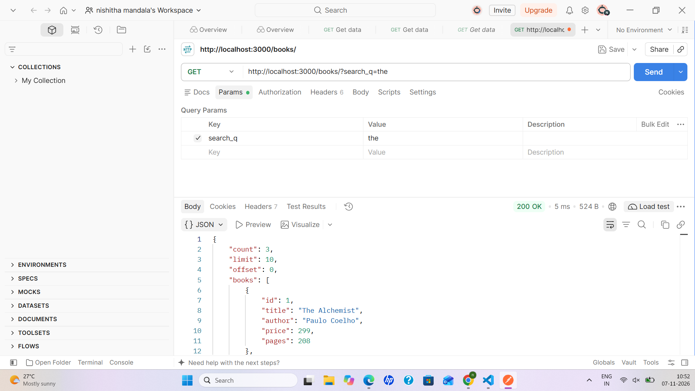

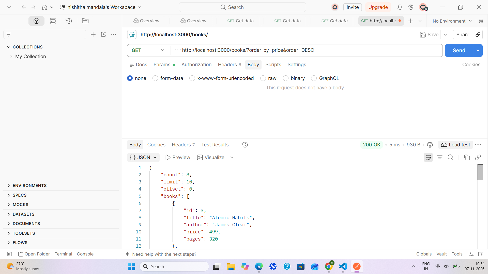

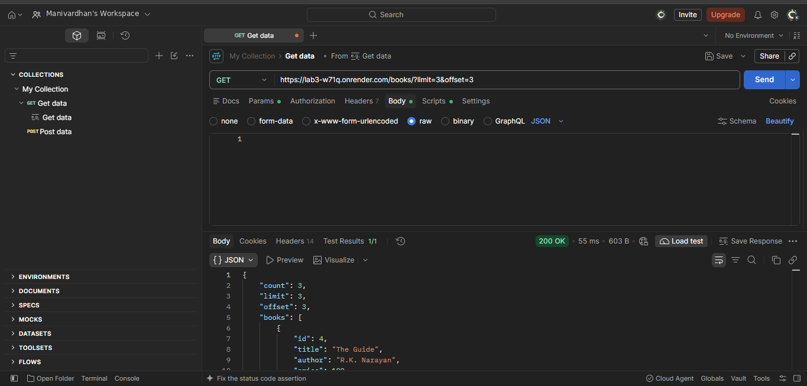

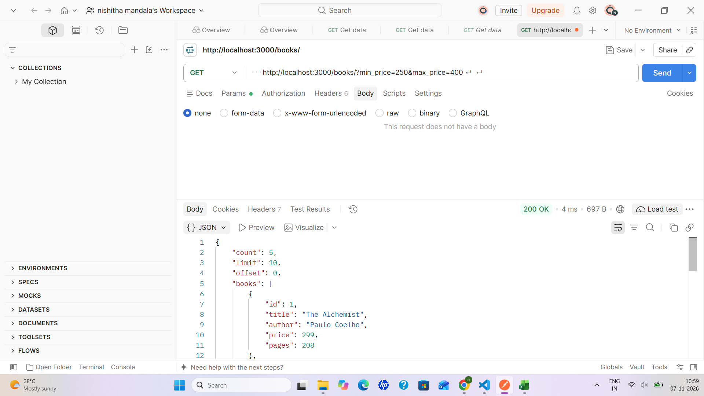

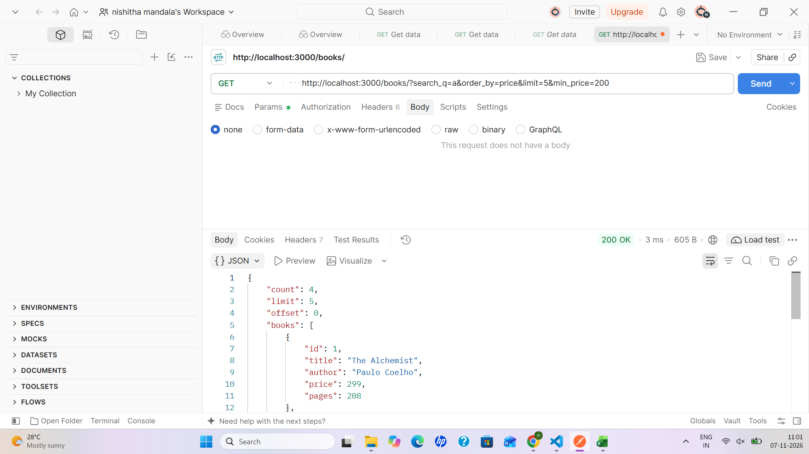

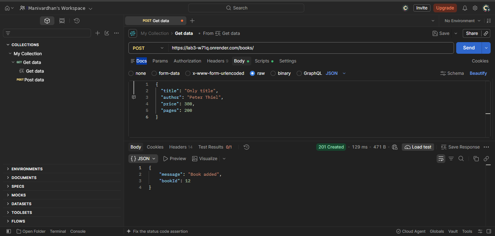

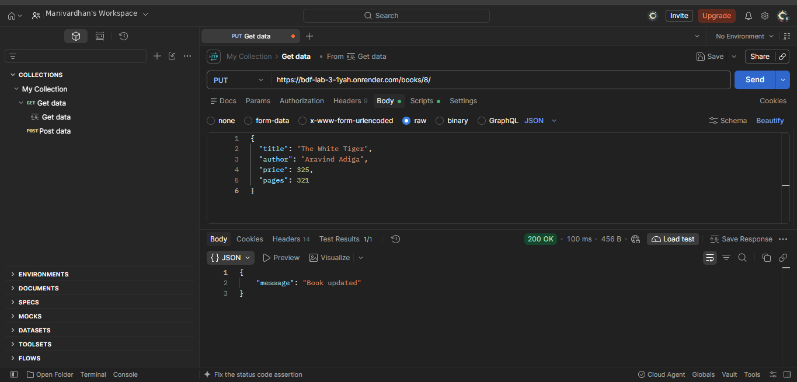

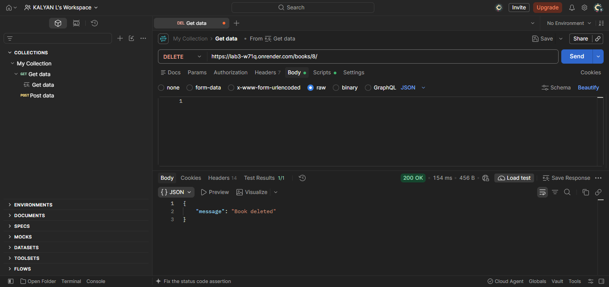

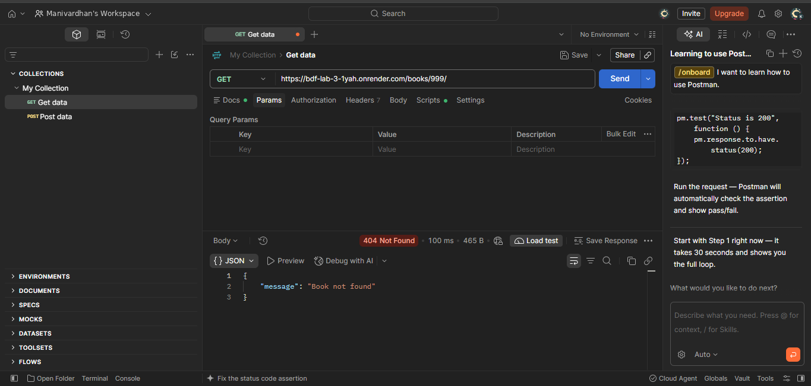

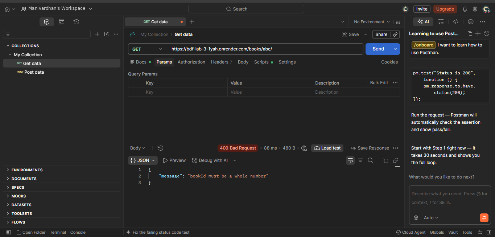

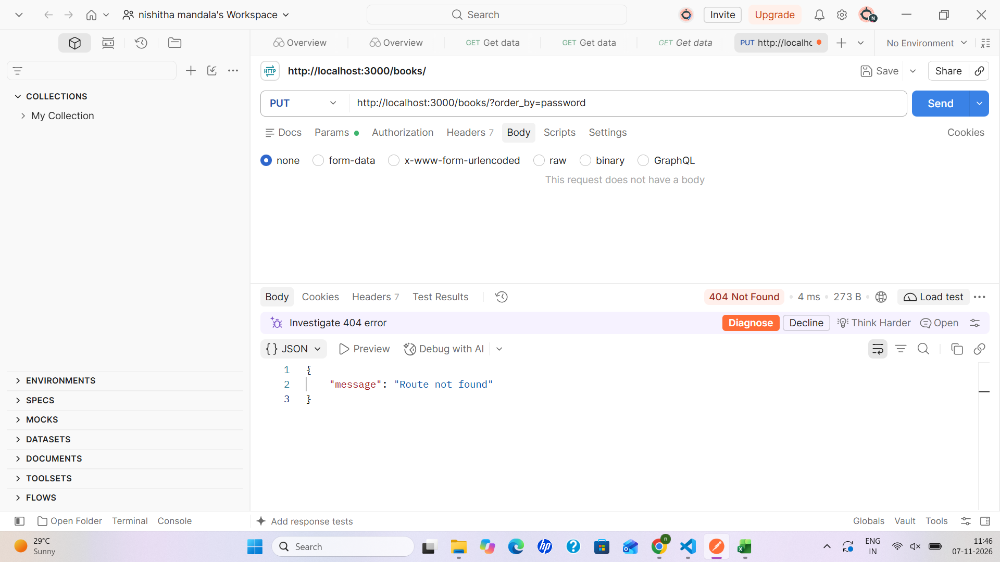

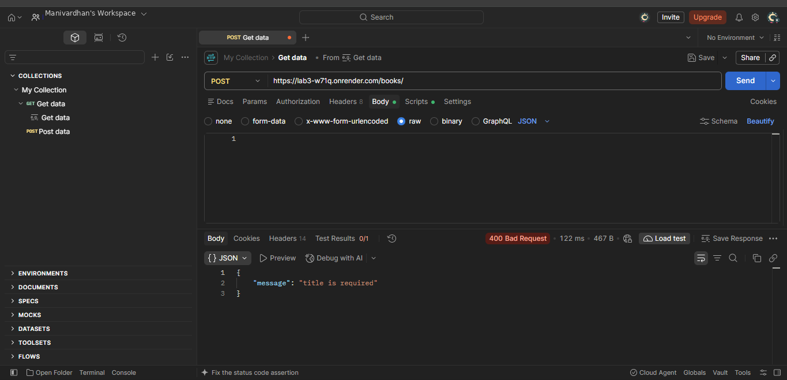

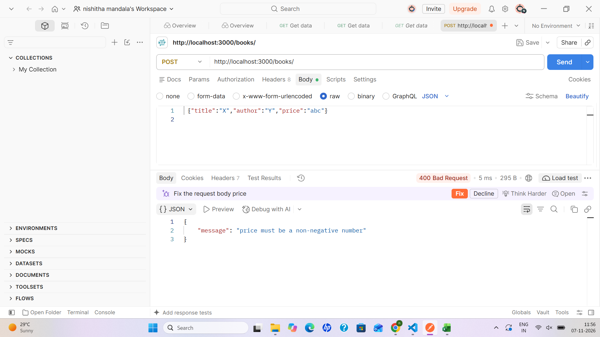

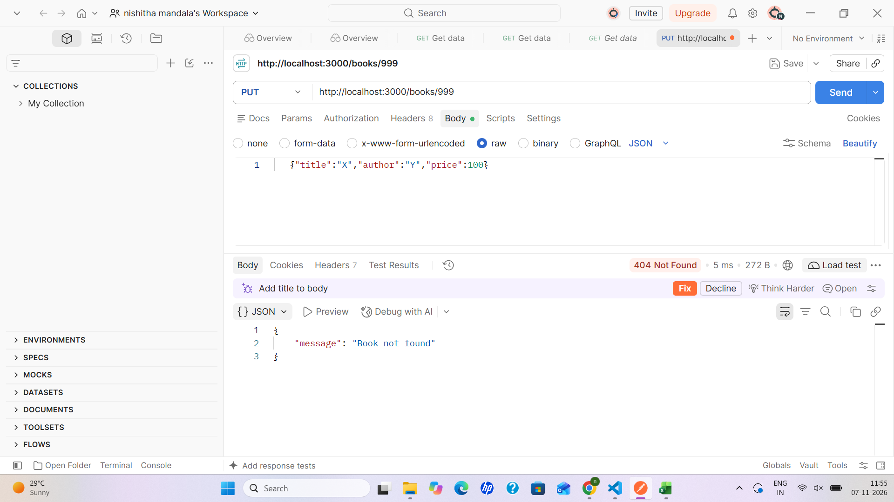

---

## 8. Deployment on Render

The API is deployed as a **Web Service** on [Render](https://render.com).

**Build command:** `npm install`
**Start command:** `npm start`
**Environment variable:** `PORT` is provided automatically by Render.

> [!NOTE]
> `sqlite3@5.1.7` is pinned specifically because newer versions require `GLIBC_2.38`,
> which is not available on Render's default Linux image. Version 5.1.7 is compatible.

### How to deploy your own copy

1. Fork or push the repository to GitHub.
2. Create a new **Web Service** on Render and connect the repository.
3. Set **Build command** to `npm install` and **Start command** to `npm start`.
4. Render assigns a `PORT` automatically — the app reads it via `process.env.PORT`.

---

## 9. Live API URL

| Resource | Method | Endpoint / URL |
|---|---|---|
| Live deployment root | GET | https://bdf-lab-3-mx28.onrender.com |
| Retrieve all books | GET | https://bdf-lab-3-mx28.onrender.com/books |
| Retrieve a specific book | GET | https://bdf-lab-3-mx28.onrender.com/books/1 |
| Add a new book | POST | https://bdf-lab-3-mx28.onrender.com/books |
| Update a book | PUT | https://bdf-lab-3-mx28.onrender.com/books/:id |
| Delete a book | DELETE | https://bdf-lab-3-mx28.onrender.com/books/:id |
| Root route (returns 404) | GET | https://bdf-lab-3-mx28.onrender.com/ |

> [!IMPORTANT]
> Visiting `https://bdf-lab-3-mx28.onrender.com/` returns `{ "message": "Route not found" }` —
> this is expected behaviour. The API is served under `/books`.

---

## Notes

- **Design choice:** Placeholders (`?`) cannot be used for column names, so `order_by` and
  `order` are checked against a fixed whitelist before they are put into the query. All other
  user input goes through placeholders.

### Debugging notes (problems I faced and how I fixed them)

- **`no such table: book`:** Running the SQLite command line from the wrong folder created a
  new, empty `books.db` that had no table. I deleted the empty file, moved into the correct
  folder (`lab-03`) and ran the command again, and the real database was found.
- **`getaddrinfo ENOTFOUND books` in Postman:** I typed only `/books/...` as the URL, so
  Postman treated `books` as a website name. I used the full URL starting with
  `http://localhost:3000`.
- **400 "title is required" instead of 404 on PUT:** The request had no body. The server
  validates the input first and checks whether the record exists second. I added a raw JSON
  body, and then the server returned 404 for the missing book.
- **Render deploy failed with `GLIBC_2.38 not found`:** The newest `sqlite3` package needs a
  newer Linux library than Render has. I installed `sqlite3@5.1.7`, pushed the change, and
  the deploy succeeded.
- **Thousands of changes in Source Control:** `node_modules` was not ignored yet. I created
  `.gitignore` with `node_modules/` and `.env`, and the count dropped to a few files.

### Debugging reference: common errors and fixes

| Error | Cause | Fix |
|---|---|---|
| `EADDRINUSE: address already in use :::3000` | Another process is already using the port | Stop the old server (`Ctrl+C`), or find the process with `netstat -ano \| findstr :3000` and stop it with `taskkill /PID <number> /F` |
| `Cannot find module './...'` | Wrong import path or file name in `require(...)` | Correct the path and spelling |
| `no such table: ...` | Typo in the table name, or the wrong database file | Use the real table name (`book`) and check the database path |
| Route returns `{}` or a Promise | Missing `await` on `db.get`, `db.all` or `db.run` | Add `await` and make the handler `async` |
